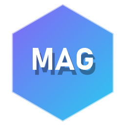
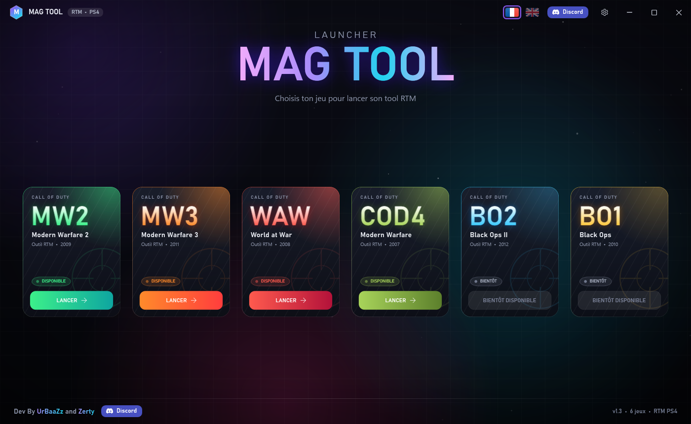
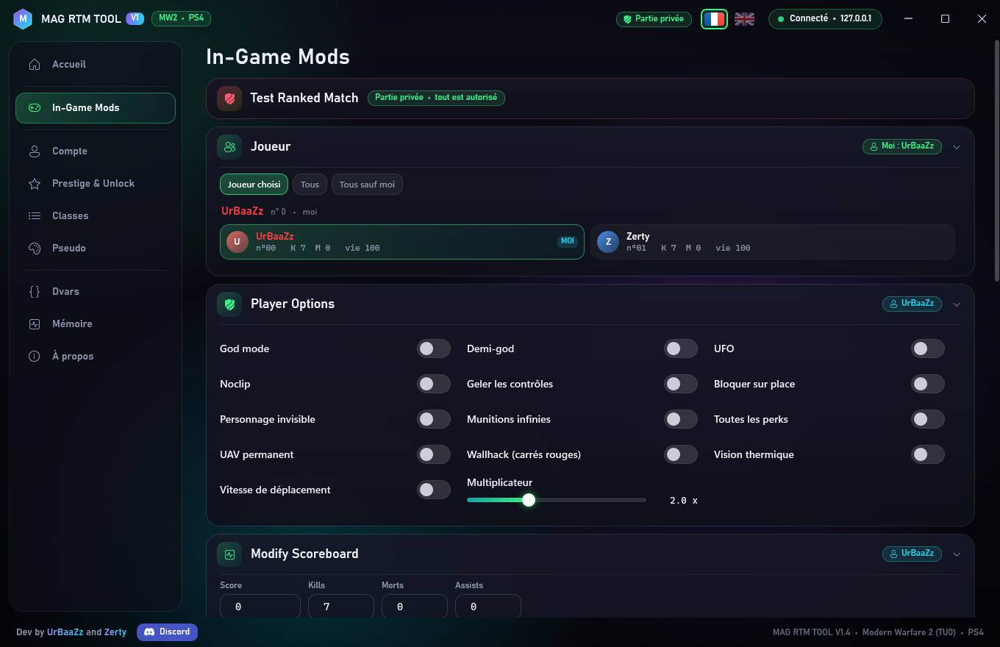
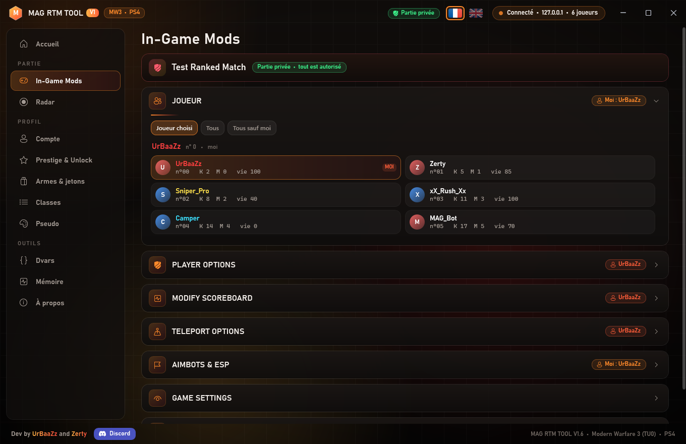
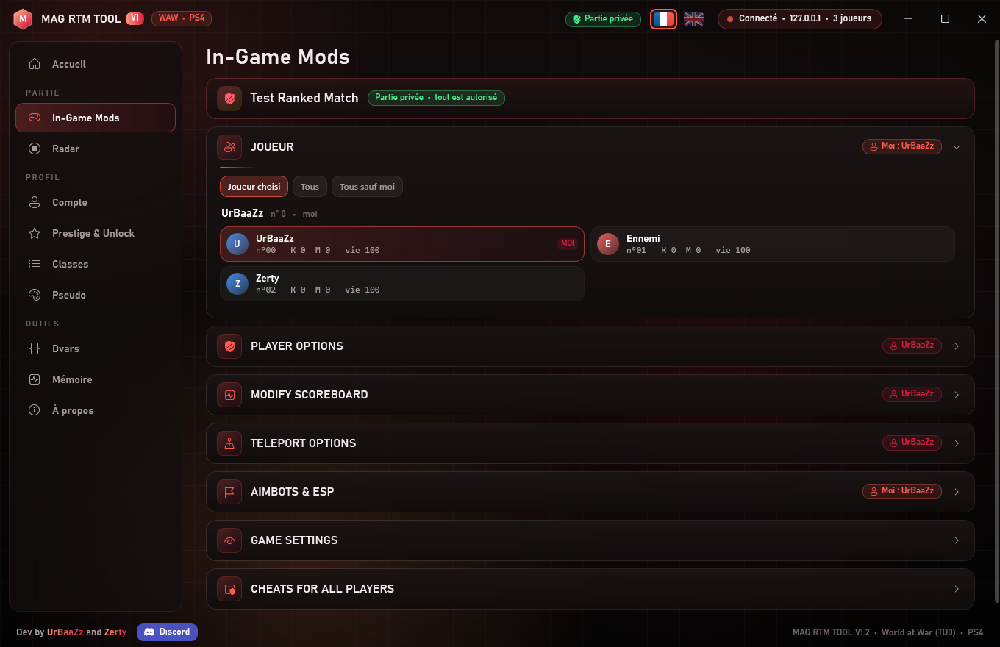
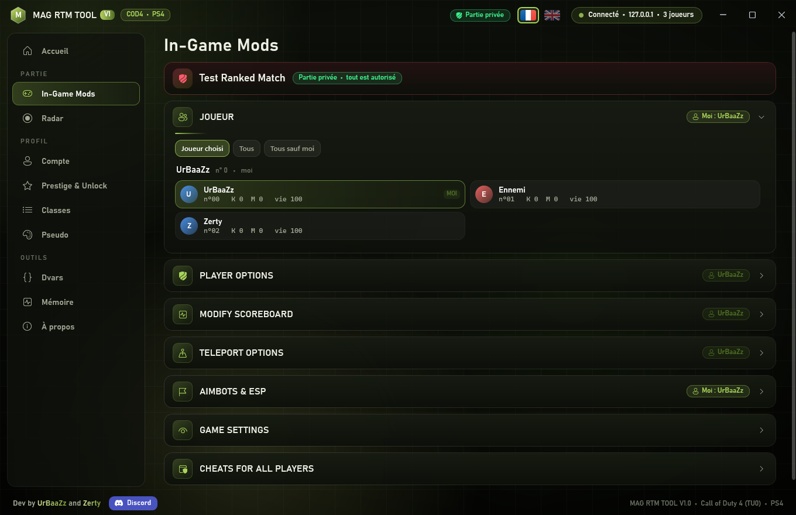

if you like this project, leave a star ⭐️ 

  

<h1 align="center">MAG TOOL</h1>

  Launcher and RTM tools for Call of Duty on PS4: <b>Modern Warfare 2</b>, <b>Modern Warfare 3</b>, <b>World at War</b> and <b>Call of Duty 4</b>. 
  Dev by <b>UrBaaZz</b> and <b>Zerty</b>

  <a href="https://github.com/a5x/MULTI-COD-MAG-RTM-TOOL/raw/main/MAG_TOOL.zip"><b>⬇️ Download MAG TOOL</b></a>
  &nbsp;•&nbsp;
  <a href="TUTORIEL.md"><b>📖 Tutorial</b></a>
  &nbsp;•&nbsp;
  <a href="https://discord.gg/m7e6S2agGU"><b>Discord</b></a>

## Contents

|Program                |For                                      |
|-----------------------|-----------------------------------------|
|**MAG TOOL Launcher**  |Choose your game and launch its tool     |
|**MAG RTM TOOL MW2**   |Modern Warfare 2 (PS4 port)              |
|**MAG RTM TOOL MW3**   |Modern Warfare 3 (PS4 port)              |
|**MAG RTM TOOL WAW**   |World at War (PS4 port)                  |
|**MAG RTM TOOL COD4**  |Call of Duty 4: Modern Warfare (PS4 port)|
|Black Ops II, Black Ops|Coming soon                              |

In each tool:

- **In-Game Mods** (host): god mode, UFO, noclip, infinite ammo, wallhack, aimbot, teleports, scoreboard, match settings, cheats for all players.
- **Test Ranked Match** always active: in ranked matches, cheats are automatically blocked.
- **Account, Prestige & Unlock, Classes**: stats, prestige, level, unlock everything, class names and content.
- **Gamertag**: colors, animated rainbow, controller button icons, scrolling clan tags.
- **Dvars, Memory** to go further.
- Launcher and tools in **French and English** (flags at the top right).
- **Online players** displayed in the launcher (anonymous signal, can be disabled in Settings).

## Requirements

- A PS4 with **GoldHEN** and the **ps4debug** payload active.
- The game running on the PS4, at the multiplayer menu.
- A **Windows 10 or 11** PC (.NET Framework 4.8, already included in Windows), on the same network as the PS4.

## Installation

Everything is explained step by step, with images, in the **[📖 Tutorial](TUTORIEL.md)** (install, connect your PS4, use the tools, updates, common issues). In short:

1. Download **[MAG_TOOL.zip](https://github.com/a5x/MULTI-COD-MAG-RTM-TOOL/raw/main/MAG_TOOL.zip)** and extract it wherever you want (nothing to install).
2. Run **MAG TOOL Launcher.exe**.  
   If Windows shows “Windows protected your PC” (unsigned program): click **More info** then **Run anyway**.
3. Choose your game > **LAUNCH**, then in the tool: enter your PS4’s IP > **Connect**.

## Updates

Every time they open, the launcher and tools check this page for a new version. If one is available, an **Update available** window opens and the **Download** button takes you to this page.  
Download the new **MAG_TOOL.zip** and extract it over your “MAG TOOL” folder: your settings (PS4 IP, gamertag, etc.) are kept.

## Screenshots

|MW2                   |MW3                   |
|----------------------|----------------------|
|||

|World at War                   |Call of Duty 4                    |
|-------------------------------|----------------------------------|
|||

## Contact

- Discord server: **https://discord.gg/m7e6S2agGU**
- UrBaaZz: `urbaazz` • Zerty: `jlzerty`

Fan project, not affiliated with Activision. For use in private matches. See <LICENCE.txt>.
