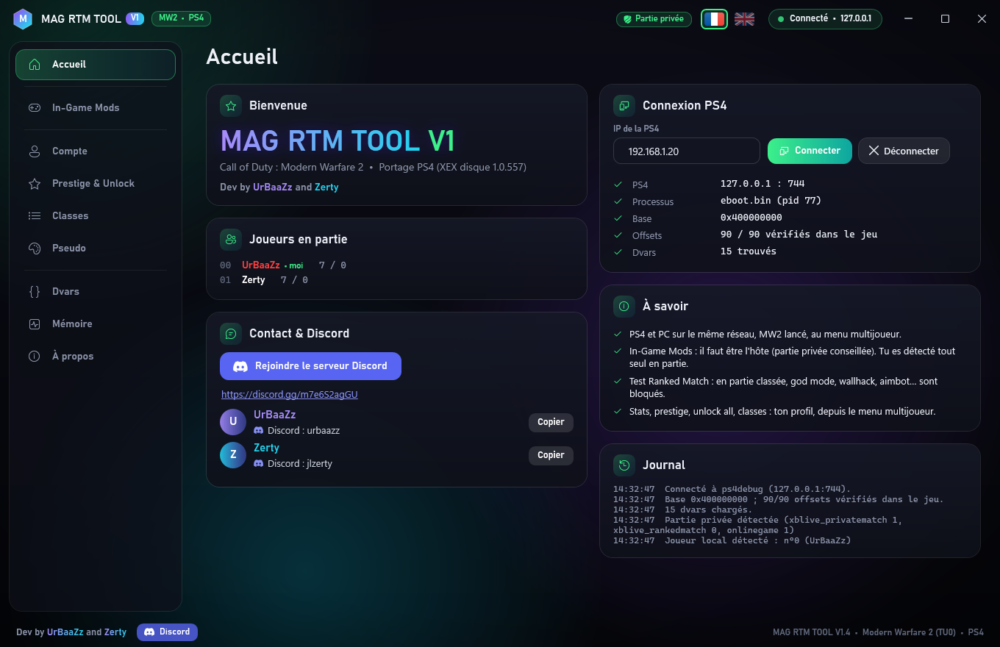
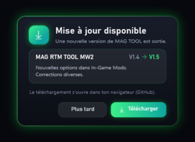

<h1 align="center">📖 Tutoriel MAG TOOL</h1>

<p align="center">
  Installer, connecter ta PS4, utiliser les tools et faire les mises à jour.<br>
  Dev by <b>UrBaaZz</b> and <b>Zerty</b> • <a href="#english">English</a>
</p>

---

## 1. Ce qu'il te faut

- Une **PS4** avec **GoldHEN** et le payload **ps4debug** chargé.
- Le **jeu** lancé sur la PS4 : Modern Warfare 2, Modern Warfare 3, World at War ou Call of Duty 4 (portage PS4), au **menu multijoueur**.
- Un **PC Windows 10 ou 11**, branché sur **la même box / le même réseau** que la PS4.
  Rien d'autre à installer : .NET Framework 4.8 est déjà dans Windows.

## 2. Installer

1. Télécharge **[MAG_TOOL.zip](https://github.com/a5x/MULTI-COD-MAG-RTM-TOOL/raw/main/MAG_TOOL.zip)**.
2. Clic droit sur le zip > **Extraire tout…** et choisis un dossier simple, par exemple le **Bureau** ou **Documents**.
   - ⚠️ Ne lance pas le launcher **depuis l'intérieur du zip** : extrais-le d'abord, sinon il ne trouve pas les tools et ne garde pas tes réglages.
   - Évite `C:\Program Files` : les tools doivent pouvoir écrire leurs réglages à côté d'eux.
3. Ouvre le dossier **MAG TOOL** et lance **MAG TOOL Launcher.exe**.
   Si Windows affiche « Windows a protégé votre ordinateur » (le programme n'est pas signé) : **Informations complémentaires** > **Exécuter quand même**.

Ce que contient le dossier :

```
MAG TOOL\
├─ MAG TOOL Launcher.exe     le launcher
├─ TUTORIEL.txt              ce tutoriel
└─ Tools\
   ├─ MW2\  MAG RTM TOOL V1.exe + LISEZMOI.txt
   ├─ MW3\  MAG RTM TOOL V1.exe + LISEZMOI.txt
   ├─ WAW\  MAG RTM TOOL V1.exe + LISEZMOI.txt
   ├─ COD4\ MAG RTM TOOL V1.exe + LISEZMOI.txt
   └─ BO2\, BO1\             bientôt
```

Ne renomme pas et ne déplace pas les dossiers `Tools\MW2`, `Tools\MW3`, `Tools\WAW`, `Tools\COD4` : c'est là que le launcher cherche les tools.

## 3. Lancer un tool


1. Dans le launcher, clique sur la carte de ton jeu > **LANCER**.
2. Langue : **drapeau français ou anglais** en haut à droite (dans le launcher et dans chaque tool).

## 4. Connecter ta PS4

**Trouver l'IP de ta PS4** : sur la PS4, **Paramètres > Réseau > Afficher l'état de la connexion** > ligne **Adresse IP** (par exemple `192.168.1.20`).



1. Sur la PS4 : GoldHEN actif, **ps4debug chargé**, le jeu lancé au **menu multijoueur**.
2. Dans le tool, page **Accueil** : tape l'**IP de la PS4** > **Connecter**.
3. C'est bon quand tout est coché (PS4, Processus, Base, Offsets, Dvars) et que le haut de la fenêtre affiche **Connecté**.

> Après un redémarrage ou un mode repos de la PS4, il faut **recharger ps4debug** avant de reconnecter le tool.

## 5. Utiliser le tool


| Page | À quoi elle sert |
| --- | --- |
| **In-Game Mods** | En partie : god mode, UFO, noclip, munitions infinies, wallhack, aimbot, téléportations, scores, réglages de la partie, triches pour tous. **Tu dois être l'hôte** (partie privée conseillée). Clique sur un titre pour ouvrir / fermer sa section. Tu es détecté tout seul (badge **MOI**). |
| **Test Ranked Match** | Toujours actif : en **partie classée**, les triches sont bloquées automatiquement (elles reprennent en partie privée). |
| **Radar** (MW3, WaW, COD4) | La partie vue du ciel, en direct. |
| **Compte** | Fiche de combat, temps de jeu, clan tag (MW2). |
| **Prestige & Unlock** | Prestige, niveau, tout débloquer, carte de visite. |
| **Armes & jetons** (MW3) | Armes au niveau max, double XP, jetons de prestige. |
| **Classes** | Noms et contenu des classes. |
| **Pseudo** | Pseudo en couleur, arc-en-ciel animé, icônes des touches de la manette. |
| **Dvars, Mémoire** | Pour les utilisateurs avancés. |

- Stats, prestige, classes : fais-le depuis le **menu multijoueur**, puis change d'écran pour voir le résultat. Le jeu sauvegarde à sa prochaine écriture des stats (fin de partie).
- Les options cochées sont réappliquées en continu (après une mort, un respawn…).

## 6. Mises à jour

À chaque ouverture, le launcher et les tools regardent sur GitHub s'il existe une nouvelle version. Si oui :



1. Clique **Télécharger** : la page GitHub s'ouvre dans ton navigateur. (« Plus tard » : le message reviendra à la prochaine ouverture.)
2. Télécharge le nouveau **MAG_TOOL.zip**.
3. Extrais-le **par-dessus** ton dossier **MAG TOOL** et accepte de **remplacer les fichiers**.

Tes réglages sont gardés : ils sont dans les fichiers **`.cfg`** (`MAG_TOOL_Launcher.cfg` et `Tools\<JEU>\MAG_RTM_TOOL.cfg`, avec l'IP de ta PS4, ton pseudo, ta langue…). **Ne les supprime pas.**
Sans internet, rien ne change : tout marche normalement, simplement sans message de mise à jour.

**Compteur d'utilisateurs** : le launcher affiche combien de personnes utilisent MAG TOOL en ce moment (en haut et sur chaque carte). Pour ça, le launcher et les tools envoient toutes les 5 minutes un **signal anonyme** : un numéro tiré au hasard sur ton PC, le jeu et la version. Rien d'autre (pas d'IP enregistrée, pas de pseudo, rien sur ta PS4). Pour le couper : **Paramètres** du launcher (roue dentée) > **Compteur d'utilisateurs en ligne**.

## 7. Problèmes fréquents

| Problème | Solution |
| --- | --- |
| **Connexion impossible / refusée** | Vérifie l'IP de la PS4, que **ps4debug est chargé** (à refaire après un redémarrage ou un mode repos), que le PC et la PS4 sont sur le **même réseau** et que le jeu est lancé. |
| La carte du jeu affiche **BIENTÔT** | Le tool n'est plus dans `Tools\<JEU>` : remets-le, ou choisis-le dans les **Paramètres** du launcher (roue dentée) > **Choisir le .exe**. |
| **Options refusées**, « Partie classée • options bloquées » | Normal : le Test Ranked Match bloque les triches en partie classée. Joue en **partie privée**. |
| Les options In-Game Mods ne font rien | Tu dois être **l'hôte** de la partie. |
| Stats / prestige pas visibles | Change d'écran dans le jeu ; ils sont sauvegardés à la fin de la partie. |
| Fenêtre **« Tool désactivé »** | UrBaaZz et Zerty ont mis le tool en pause (maintenance…) : leur message explique pourquoi. Il revient tout seul dès qu'il est réactivé (internet nécessaire). Infos sur le Discord. |
| L'antivirus bloque le tool | Faux positif fréquent pour un programme non signé. Télécharge-le **uniquement ici**, puis ajoute une exception. |
| Autre souci | Envoie le **Journal** (page Accueil du tool) sur le **[Discord](https://discord.gg/m7e6S2agGU)**. |

## Contact

Serveur Discord : **https://discord.gg/m7e6S2agGU** • UrBaaZz : `urbaazz` • Zerty : `jlzerty`

---

<h2 id="english">English</h2>

1. **You need**: a **PS4** with **GoldHEN** and the **ps4debug** payload loaded; the game (MW2, MW3, World at War or Call of Duty 4 PS4 port) at the **multiplayer menu**; a **Windows 10/11 PC** on the **same network**.
2. **Install**: download **[MAG_TOOL.zip](https://github.com/a5x/MULTI-COD-MAG-RTM-TOOL/raw/main/MAG_TOOL.zip)**, right-click > **Extract All…** (Desktop or Documents, not inside the zip, not Program Files), then run **MAG TOOL Launcher.exe**. If Windows says « Windows protected your PC »: **More info** > **Run anyway**. Don't rename or move the `Tools\MW2`, `Tools\MW3`, `Tools\WAW`, `Tools\COD4` folders.
3. **Launch**: click your game's card > **LAUNCH**. Language: **flags** at the top right.
4. **Connect**: PS4 IP = **Settings > Network > View Connection Status** > **IP Address**. In the tool's **Home** page, type it > **Connect**. Reload ps4debug after a PS4 restart or rest mode.
5. **Use**: **In-Game Mods** needs you to be the **host** (private match recommended). **Test Ranked Match** is always on: cheats are blocked in ranked matches. Stats / prestige / classes: from the multiplayer menu.
6. **Updates**: when a new version is out, a window opens: **Download** opens this page. Download the new MAG_TOOL.zip and extract it **over** your MAG TOOL folder (replace the files). Your settings are in the **`.cfg`** files: **don't delete them**. Online counter: the launcher and the tools send an **anonymous signal** every 5 minutes (a random number for your PC, the game and the version, nothing else); turn it off in the launcher **Settings**.
7. **Problems**: can't connect → check the IP, ps4debug, same network, game running. Card shows **SOON** → put the tool back in `Tools\<GAME>` or pick it in the launcher **Settings**. Options refused → ranked match, play a private match. « Tool disabled » window → the developers paused the tool (maintenance…), it comes back by itself once re-enabled. Anything else → send the tool's **Log** (Home page) on **[Discord](https://discord.gg/m7e6S2agGU)**.
